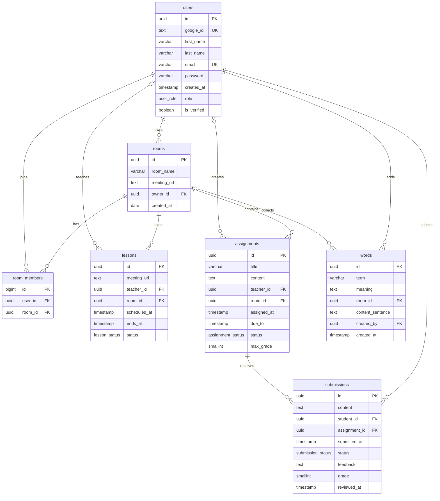

# Database Schema

Linguistix stores its data in **PostgreSQL**, with migrations managed by [`node-pg-migrate`](https://github.com/salsita/node-pg-migrate).

- Migrations live in `migrations/`. From `apps/api`, run them with `pnpm migrate:dev up` (uses `../../.env`) or `pnpm migrate:test up` (uses `../../.env.test`).
- The current schema is defined in a single migration: `migrations/1791052707599_init.ts`.
- Short-lived data (refresh tokens, one-time tokens, cooldowns, rate-limit counters and the email job queue) lives in **Redis** instead; see [Redis](#redis).
- Most primary keys are UUID v7 (`DEFAULT uuidv7()`), so IDs sort by creation time. The built-in `uuidv7()` function needs **PostgreSQL 18+**. The `room_members` table uses a `BIGINT` identity column instead.

## Overview

| Table          | Purpose                                                           |
| -------------- | ----------------------------------------------------------------- |
| `users`        | Every account on the platform, either a student or a teacher.     |
| `rooms`        | Classrooms or study groups, each with one owner.                  |
| `room_members` | Join table linking users to the rooms they belong to.             |
| `lessons`      | Scheduled live sessions in a room, run by a teacher.              |
| `assignments`  | Homework a teacher sets for a room.                               |
| `submissions`  | A student's answer to an assignment, with its grade and feedback. |
| `words`        | Vocabulary entries, collected in a room or not tied to any room.  |

## ER Diagram

## Enum Types

| Type                | Values                                               | Used by              |
| ------------------- | ---------------------------------------------------- | -------------------- |
| `user_role`         | `student`, `teacher`                                 | `users.role`         |
| `lesson_status`     | `scheduled`, `completed`, `canceled`, `in_progress`  | `lessons.status`     |
| `assignment_status` | `draft`, `published`, `closed`                       | `assignments.status` |
| `submission_status` | `pending`, `submitted`, `needs_revision`, `reviewed` | `submissions.status` |

## Tables

### `users`

Every account on the platform. The `role` column decides whether the user is a student or a teacher. Accounts created through Google sign-in have no password, start with no role and are verified from the start.

| Column        | Type           | Null | Default        | Notes                                     |
| ------------- | -------------- | ---- | -------------- | ----------------------------------------- |
| `id`          | `UUID`         | no   | `uuidv7()`     | Primary key                               |
| `google_id`   | `TEXT`         | yes  |                | Unique. Google account ID, if linked      |
| `first_name`  | `VARCHAR(100)` | no   |                |                                           |
| `last_name`   | `VARCHAR(100)` | no   |                |                                           |
| `email`       | `VARCHAR(255)` | no   |                | Unique                                    |
| `password`    | `VARCHAR(255)` | yes  |                | Password hash. `NULL` for Google accounts |
| `created_at`  | `TIMESTAMP`    | no   | `CURRENT_DATE` | Default is midnight of the current day    |
| `role`        | `user_role`    | yes  |                | `NULL` until the user picks a role        |
| `is_verified` | `BOOLEAN`      | no   | `FALSE`        | Whether the email address is verified     |

### `rooms`

A classroom or study group. Lessons and assignments always belong to a room; vocabulary may.

| Column        | Type           | Null | Default        | Notes                                 |
| ------------- | -------------- | ---- | -------------- | ------------------------------------- |
| `id`          | `UUID`         | no   | `uuidv7()`     | Primary key                           |
| `room_name`   | `VARCHAR(100)` | no   |                |                                       |
| `meeting_url` | `TEXT`         | yes  |                | Default video-call link for the room  |
| `owner_id`    | `UUID`         | no   |                | FK → `users.id`, `ON DELETE RESTRICT` |
| `created_at`  | `DATE`         | no   | `CURRENT_DATE` |                                       |

Because of `RESTRICT`, you cannot delete a user who still owns a room. Delete the room or transfer ownership first.

### `room_members`

Many-to-many join table between `users` and `rooms`. A user can join a given room only once: `UNIQUE (user_id, room_id)`.

| Column    | Type     | Null | Default                        | Notes                                |
| --------- | -------- | ---- | ------------------------------ | ------------------------------------ |
| `id`      | `BIGINT` | no   | `GENERATED ALWAYS AS IDENTITY` | Primary key                          |
| `user_id` | `UUID`   | no   |                                | FK → `users.id`, `ON DELETE CASCADE` |
| `room_id` | `UUID`   | no   |                                | FK → `rooms.id`, `ON DELETE CASCADE` |

### `lessons`

A live session in a room, run by a teacher.

| Column         | Type            | Null | Default        | Notes                                     |
| -------------- | --------------- | ---- | -------------- | ----------------------------------------- |
| `id`           | `UUID`          | no   | `uuidv7()`     | Primary key                               |
| `meeting_url`  | `TEXT`          | yes  |                | Overrides the room's link for this lesson |
| `teacher_id`   | `UUID`          | yes  |                | FK → `users.id`, `ON DELETE CASCADE`      |
| `room_id`      | `UUID`          | no   |                | FK → `rooms.id`, `ON DELETE CASCADE`      |
| `scheduled_at` | `TIMESTAMP`     | no   | `CURRENT_DATE` | Default is midnight of the current day    |
| `ends_at`      | `TIMESTAMP`     | no   |                |                                           |
| `status`       | `lesson_status` | no   | `'scheduled'`  |                                           |

### `assignments`

Homework a teacher sets for a room. Draft assignments can be incomplete. Any other status requires all content fields to be filled.

| Column        | Type                | Null  | Default    | Notes                                 |
| ------------- | ------------------- | ----- | ---------- | ------------------------------------- |
| `id`          | `UUID`              | no    | `uuidv7()` | Primary key                           |
| `title`       | `VARCHAR(255)`      | yes\* |            |                                       |
| `content`     | `TEXT`              | yes\* |            |                                       |
| `teacher_id`  | `UUID`              | yes   |            | FK → `users.id`, `ON DELETE SET NULL` |
| `room_id`     | `UUID`              | no    |            | FK → `rooms.id`, `ON DELETE CASCADE`  |
| `assigned_at` | `TIMESTAMP`         | yes\* |            |                                       |
| `due_to`      | `TIMESTAMP`         | yes\* |            | Due date                              |
| `status`      | `assignment_status` | no    | `'draft'`  |                                       |
| `max_grade`   | `SMALLINT`          | yes\* |            |                                       |

\* **`chk_published_field_not_null`**: when `status <> 'draft'`, the columns `title`, `content`, `assigned_at`, `due_to` and `max_grade` must all be non-null.

### `submissions`

A student's answer to an assignment, plus the teacher's review. A student can submit to a given assignment only once: `UNIQUE (student_id, assignment_id)`.

| Column          | Type                | Null | Default        | Notes                                      |
| --------------- | ------------------- | ---- | -------------- | ------------------------------------------ |
| `id`            | `UUID`              | no   | `uuidv7()`     | Primary key                                |
| `content`       | `TEXT`              | no   |                |                                            |
| `student_id`    | `UUID`              | no   |                | FK → `users.id`, `ON DELETE CASCADE`       |
| `assignment_id` | `UUID`              | no   |                | FK → `assignments.id`, `ON DELETE CASCADE` |
| `submitted_at`  | `TIMESTAMP`         | no   | `CURRENT_DATE` | Default is midnight of the current day     |
| `status`        | `submission_status` | no   | `'pending'`    |                                            |
| `feedback`      | `TEXT`              | yes  |                | Teacher's comments                         |
| `grade`         | `SMALLINT`          | yes  |                |                                            |
| `reviewed_at`   | `TIMESTAMP`         | yes  |                | Set when the teacher reviews it            |

### `words`

Vocabulary entries, each with its meaning and an example sentence. A word with `room_id = NULL` is not tied to any room.

| Column             | Type           | Null | Default        | Notes                                  |
| ------------------ | -------------- | ---- | -------------- | -------------------------------------- |
| `id`               | `UUID`         | no   | `uuidv7()`     | Primary key                            |
| `term`             | `VARCHAR(255)` | no   |                |                                        |
| `meaning`          | `TEXT`         | no   |                |                                        |
| `room_id`          | `UUID`         | yes  |                | FK → `rooms.id`, `ON DELETE CASCADE`   |
| `content_sentence` | `TEXT`         | no   |                | Example sentence that uses the term    |
| `created_by`       | `UUID`         | no   |                | FK → `users.id`, `ON DELETE SET NULL`  |
| `created_at`       | `TIMESTAMP`    | no   | `CURRENT_DATE` | Default is midnight of the current day |

> `created_by` is `NOT NULL` but its foreign key is `ON DELETE SET NULL`. Deleting a user who added any word therefore fails with a not-null violation.

## Delete Behaviour

| When this is deleted… | Effect                                                                                                                                                                                    |
| --------------------- | ----------------------------------------------------------------------------------------------------------------------------------------------------------------------------------------- |
| **User**              | Blocked if the user owns a room or added any word. Otherwise their memberships, lessons and submissions are deleted, and their assignments keep existing with `teacher_id` set to `NULL`. |
| **Room**              | Its memberships, lessons, assignments (and so their submissions) and words are deleted.                                                                                                   |
| **Assignment**        | Its submissions are deleted.                                                                                                                                                              |

Redis keys are not linked to PostgreSQL rows, so deleting a user does **not** delete their one-time tokens. They expire on their own within 15 minutes; using one in the meantime fails with `USER_NOT_FOUND`.

## Redis

Redis holds data that expires on its own. Every key below is set with a TTL, except the BullMQ queue keys.

### Refresh tokens

Login sessions (`RefreshTokenRepo` in `src/features/auth/auth.repository.ts`). Only the SHA-256 hash of a refresh token is stored.

| Key                          | Value               | TTL                              | Purpose                                     |
| ---------------------------- | ------------------- | -------------------------------- | ------------------------------------------- |
| `refreshToken:<tokenHash>`   | user ID             | Until the session expires        | Looks up the user of a refresh token        |
| `refreshToken:user:<userId>` | set of token hashes | Until the newest session expires | Lists a user's sessions, to revoke them all |

- **Refreshing** rotates the token: the old key is read and deleted in one step (`GETDEL`), so a token can be used only once, even under concurrent requests.
- **Logging out** deletes the token. **Resetting the password** revokes every session of the user.
- Deleting a user in Postgres does not delete their tokens. Their next refresh fails with `401` and revokes the rest.

### One-time tokens

Email verification and password reset tokens (`VerificationTokenRepo` in `src/features/auth/auth.repository.ts`). Only the SHA-256 hash of a token is stored. `<subject>` is the purpose of the token: `email` for email verification, `reset-password` for password reset. Tokens with different subjects never match each other.

| Key                                         | Value      | TTL        | Purpose                                          |
| ------------------------------------------- | ---------- | ---------- | ------------------------------------------------ |
| `verificationToken:<tokenHash>:<subject>`   | user ID    | 15 minutes | Looks up the user of a token                     |
| `verificationToken:user:<userId>:<subject>` | token hash | 15 minutes | Finds the current token of a user, to replace it |

- **Issuing** a token deletes the user's previous token with the same subject, so a user has at most one valid token per subject.
- **Consuming** a token reads and deletes it in one step (`GETDEL`), so it can be used only once, even under concurrent requests. The user's index key is deleted too.
- An expired token simply no longer exists; there is no `used_at` or `expires_at` to check.

### Cooldowns and rate limits

| Key                          | TTL        | Purpose                                                                                                  |
| ---------------------------- | ---------- | -------------------------------------------------------------------------------------------------------- |
| `cooldown:<email>:<subject>` | 60 seconds | Per-email cooldown. `<subject>` is `resend-email-verification` or `reset-password`                       |
| `rl:global:<ip>`             | 1 minute   | Global rate limit, 100 requests per IP                                                                   |
| `rl:auth:<ip>:<path>`        | 15 minutes | Auth rate limit, 10 requests per IP and endpoint (register, login, Google callback)                      |
| `rl:strict:<ip>:<path>`      | 10 minutes | Strict rate limit, 3 requests per IP and endpoint (resend verification, forgot password, reset password) |

`<ip>` is the client IP, with IPv6 addresses grouped by `/56` subnet.

### Email queue

Emails are sent through the BullMQ queue `email-queue` (keys prefixed `bull:email-queue:`). Jobs are retried up to 3 times with exponential backoff; completed jobs are removed, and the last 500 failed jobs are kept.
